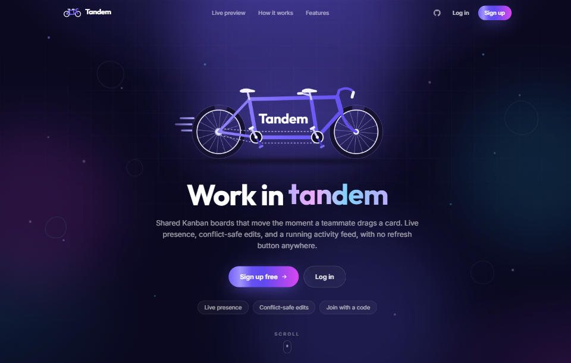
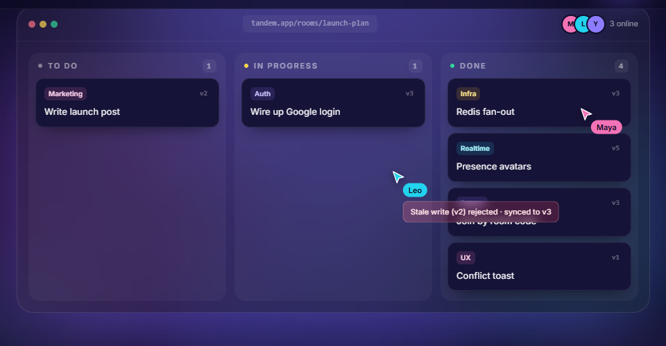

# Tandem

Shared Kanban boards that move the moment a teammate drags a card. Live presence, conflict-safe edits, and a running activity feed — no refresh button anywhere.

[](https://github.com/s4natk/tandem)
[](LICENSE)

<p align="center">
  
</p>

<p align="center">
  
</p>

## Features

- **Workspaces and rooms** — create a workspace, open a board, and share a short join code.
- **Realtime Kanban** — drag cards and columns with optimistic local updates and authoritative server reconciliation.
- **Conflict-safe edits** — every card move is versioned. Stale writes are rejected and the client resyncs instead of overwriting someone else's work.
- **Live presence** — an avatar bar shows who is in the room; watcher rings show who is looking at each card.
- **Activity feed** — every create, move, and delete streams into a shared sidebar.
- **Reconnect-safe** — board state lives in Postgres. A reconnecting client receives a full snapshot and current presence.
- **Horizontal scale** — Socket.IO uses the Redis adapter so multiple API instances broadcast as one room.
- **Optional attachments** — S3 presigned uploads when AWS credentials are present; the rest of the app runs without them.

## Tech stack

| Layer            | Choice                                                     |
| ---------------- | ---------------------------------------------------------- |
| Frontend         | React 18, TypeScript, Vite, Tailwind, Zustand, TanStack Query, Framer Motion |
| Drag and drop    | `@dnd-kit/core` + `@dnd-kit/sortable`                      |
| Realtime         | Socket.IO with `@socket.io/redis-adapter`                  |
| Backend          | Node 20, Fastify 5, Pino, Zod                              |
| Auth             | Argon2id passwords, rotating JWT access + refresh tokens   |
| Database         | PostgreSQL 16 via Prisma 5                                 |
| Cache / pub-sub  | Redis 7 (presence, rate limits, Socket.IO fan-out)         |
| Object storage   | AWS S3 via presigned URLs (optional)                       |
| Tests            | Vitest                                                     |
| Deploy           | Docker, Fly.io, Vercel, and an AWS ECS/RDS/ElastiCache path |

Shared Zod schemas and the Socket.IO event contract live in `@collab/shared` so the client and server stay in lockstep.

## Architecture

```
browser (React SPA)
        │  https / wss
        ▼
   Fastify + Socket.IO
        │
        ├── Prisma ──► PostgreSQL
        └── ioredis ──► Redis  (presence, rate limits, adapter)
```

Domain logic sits in transport-agnostic services. REST routes and websocket handlers call the same board, room, and membership code. The server re-validates permissions, payloads, and version numbers on every mutation.

- Design notes: [`docs/ARCHITECTURE.md`](docs/ARCHITECTURE.md)
- Event contract: [`docs/WS_EVENTS.md`](docs/WS_EVENTS.md)
- AWS production path: [`docs/AWS_DEPLOYMENT.md`](docs/AWS_DEPLOYMENT.md)

## Repository layout

```
tandem/
├── apps/
│   ├── server/          Fastify API + Socket.IO gateway
│   └── web/             React + Vite frontend
├── packages/
│   └── shared/          Zod schemas, types, Socket.IO events
├── docs/
│   ├── ARCHITECTURE.md
│   ├── AWS_DEPLOYMENT.md
│   ├── WS_EVENTS.md
│   └── images/
├── docker-compose.yml   local Postgres + Redis
└── package.json         npm workspaces
```

## Getting started

**Needs:** Node.js 20.6+, npm 10+, and Docker Desktop.

```bash
git clone https://github.com/s4natk/tandem.git
cd tandem
npm install
```

Start Postgres and Redis:

```bash
npm run docker:up
```

Copy the environment templates (defaults match docker-compose):

```bash
cp .env.example apps/server/.env
cp apps/web/.env.example apps/web/.env
```

Apply the schema and, if you want a starter workspace, seed a local user. The seed script refuses to run when `NODE_ENV=production` and requires a password you choose:

```bash
npm run prisma:deploy
SEED_PASSWORD=choose-a-password npm run prisma:seed
```

Start both apps:

```bash
npm run dev
```

The API listens on [http://localhost:4000](http://localhost:4000) and the web app on [http://localhost:5173](http://localhost:5173).

Open two browsers (one incognito). Create two accounts, share a room code, and drag a card — both sides update live.

If this database was created earlier with `prisma migrate dev` and has no migration history, mark the committed migration as applied instead of running it again:

```bash
npx prisma migrate resolve --applied 20261014033000_init --schema apps/server/prisma/schema.prisma
```

## Scripts

```bash
npm run dev              # server + web with hot reload
npm run build            # shared, server, web
npm run test             # Vitest (server)
npm run lint             # typecheck both apps
npm run docker:up        # Postgres + Redis
npm run docker:down
npm run prisma:deploy    # apply migrations
npm run prisma:seed      # local starter user (needs SEED_PASSWORD)
npm run prisma:studio    # Prisma GUI
```

## Environment

| Variable | Where | Purpose |
| -------- | ----- | ------- |
| `DATABASE_URL` | server | PostgreSQL connection string |
| `REDIS_URL` | server | Redis connection string (`rediss://` for TLS) |
| `JWT_ACCESS_SECRET` / `JWT_REFRESH_SECRET` | server | Signing keys (32+ characters) |
| `JWT_ACCESS_TTL` / `JWT_REFRESH_TTL` | server | Token lifetimes (`15m` / `30d` by default) |
| `CORS_ORIGIN` | server | Allowed web origin |
| `SOCKET_IO_REDIS_ADAPTER` | server | Multi-instance websocket fan-out |
| `SEED_EMAIL` / `SEED_PASSWORD` | server | Local seed user only |
| `AWS_REGION` / `S3_BUCKET` / `AWS_ACCESS_KEY_ID` / `AWS_SECRET_ACCESS_KEY` | server | Optional attachments |
| `VITE_API_URL` / `VITE_WS_URL` | web | API and websocket endpoints |

See [`.env.example`](.env.example) and [`apps/server/.env.example`](apps/server/.env.example).

## How realtime works

The client authenticates the Socket.IO handshake with the same JWT it uses for REST. After joining a room, the server emits one `room:snapshot` with the board, presence list, and recent activity. Every later mutation is an acknowledged event: the server applies it in a Postgres transaction (bumping the card `version` and room `revision`), then broadcasts through the Redis adapter.

Optimistic locking on `version` is the conflict path. A stale move returns `VERSION_CONFLICT` plus the current card so the client can reconcile without a full refetch. Presence lives in Redis hashes keyed by `socketId`, so it survives across API instances.

## Deployment

The API is a multi-stage Docker image (`apps/server/Dockerfile`). The frontend is a Vite build served as a static SPA.

- **Fly.io + Vercel** — `fly.toml` and `vercel.json` are in the repo. Point `CORS_ORIGIN`, `VITE_API_URL`, and `VITE_WS_URL` at each other, use TLS Redis (`rediss://`) in production, and store secrets with the host (never in git).
- **AWS** — ECS Fargate, RDS PostgreSQL, ElastiCache Redis, S3, and CloudFront. Step-by-step in [`docs/AWS_DEPLOYMENT.md`](docs/AWS_DEPLOYMENT.md).
- **Local containers** — `docker compose up --profile app` builds the same shape as production.

Health checks: `GET /health` and `GET /ready`.

## License

[MIT](LICENSE)
